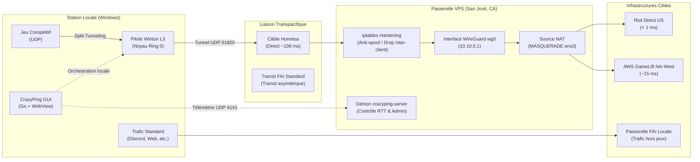

# Documentation Technique - CrazyPing

Bienvenue dans la base documentaire technique de l'infrastructure **CrazyPing**. 

CrazyPing est un système d'optimisation de transit réseau et de réduction de latence spécifiquement conçu pour les joueurs situés en Polynésie française (Tahiti). Il résout les problématiques d'asymétrie de routage BGP, de fragmentation PPPoE et d'instabilité de transit vers les infrastructures de jeux nord-américaines (Californie et Oregon) en exploitant directement le point d'atterrissement du câble sous-marin Honotua à San José.

---

## 1. Cartographie de la Documentation

La documentation est organisée de manière modulaire selon les domaines d'ingénierie suivants :

| Document | Périmètre Technique |
| :--- | :--- |
| **[Architecture Globale](ARCHITECTURE.md)** | Topologie hybride client/relais, stack technique Go, pilote virtuel L3 Wintun, WebView native et isolation noyau. |
| **[Flux & Protocoles](flows.md)** | Protocoles binaires, diagrammes de séquence Mermaid (enrôlement Curve25519, mesure RTT, administration distante). |
| **[Cas d'Utilisation](use-cases.md)** | Déroulement nominal et gestion des erreurs des scénarios opérationnels (démarrage, split-tunneling, watchdog). |
| **[Routage & Split-Tunneling](ROUTING_TABLES.md)** | Tables CIDR par jeu (Valorant, Fortnite, LoL, Overwatch, etc.), calcul du MTU optimal (1380 octets) et politiques de routage. |
| **[Déploiement & Exploitation](DEPLOYMENT.md)** | Durcissement système Linux (sysctl, BBR, iptables), services systemd, compilation binaire et packaging Windows Inno Setup. |
| **[Modèle de Sécurité](SECURITY.md)** | Architecture Zero-Trust, chiffrement WireGuard Noise_IK, isolation L3 inter-clients, mitigation des attaques UDP et anti-tampering. |
| **[Historique des Versions](changelog.md)** | Suivi chronologique des versions, ruptures d'API, ajouts de protocoles et évolutions d'infrastructure. |

---

## 2. Synthèse de l'Architecture Système

---

## 3. Spécifications Clés

- **Moteur Réseau** : WireGuard (Noise Protocol Framework, Curve25519, ChaCha20-Poly1305, BLAKE2s).
- **Driver Virtuel Windows** : Wintun (`wintun.sys` Ring 0), MTU calibré à 1380 octets.
- **Routage** : Split-tunneling sélectif par tables CIDR dédiées (aucun détournement du trafic système standard).
- **Interface Utilisateur** : Binaire autonome compilé statiquement en Go avec ressources web embarquées (`//go:embed`) affichées via Edge WebView native.
- **Supervision & Télémétrie** : Paquets binaires propriétaires de 23 octets sur UDP 4141 avec challenge cryptographique SHA-256.
