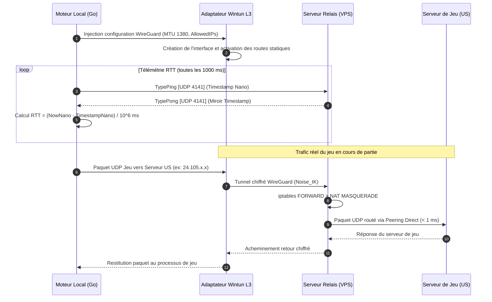
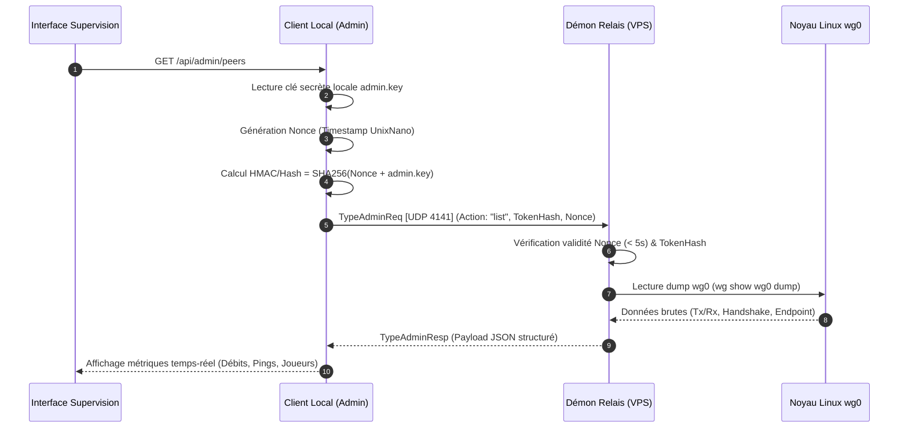
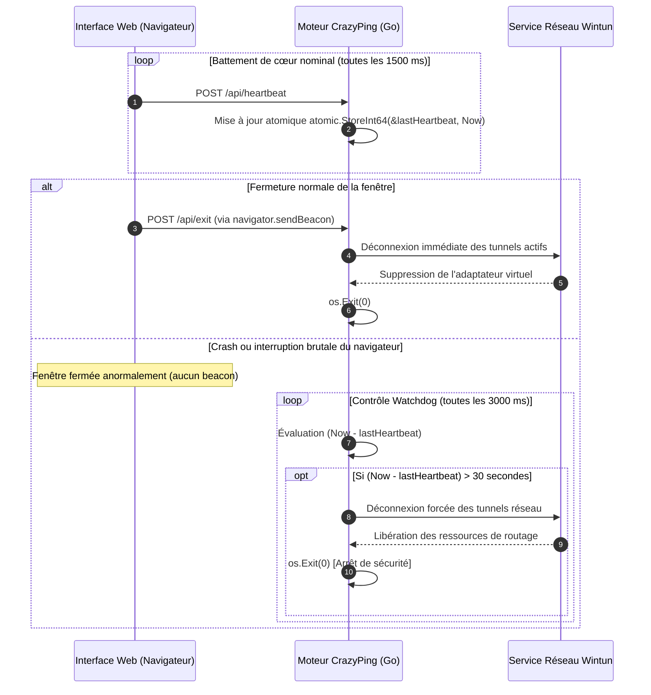

# Flux Réseau et Protocoles de Communication - CrazyPing

Ce document détaille les échanges de données, protocoles binaires et séquences opérationnelles régissant les interactions entre le client Windows, la passerelle relais Linux et les serveurs de jeu distants.

---

## 1. Format des Paquets de Contrôle et Télémétrie

CrazyPing s'appuie sur un protocole binaire compact véhiculé sur UDP (port `4141`) conçu pour minimiser l'overhead réseau sur la liaison Honotua.

### 1.1 En-tête Binaire Minimaliste (23 Octets)

```text
 0                   1                   2                   3
 0 1 2 3 4 5 6 7 8 9 0 1 2 3 4 5 6 7 8 9 0 1 2 3 4 5 6 7 8 9 0 1
+-+-+-+-+-+-+-+-+-+-+-+-+-+-+-+-+-+-+-+-+-+-+-+-+-+-+-+-+-+-+-+-+
|   Magic ('C') |   Magic ('P') |   Type (1B)   |   Seq (4B)    |
+-+-+-+-+-+-+-+-+-+-+-+-+-+-+-+-+-+-+-+-+-+-+-+-+-+-+-+-+-+-+-+-+
|                      Timestamp (UnixNano 8B)                  |
|                                                               |
+-+-+-+-+-+-+-+-+-+-+-+-+-+-+-+-+-+-+-+-+-+-+-+-+-+-+-+-+-+-+-+-+
|                       Target IPv4 (4B)                        |
+-+-+-+-+-+-+-+-+-+-+-+-+-+-+-+-+-+-+-+-+-+-+-+-+-+-+-+-+-+-+-+-+
|       Target Port (2B)        |      Payload Length (2B)      |
+-+-+-+-+-+-+-+-+-+-+-+-+-+-+-+-+-+-+-+-+-+-+-+-+-+-+-+-+-+-+-+-+
|                       Payload (Variable)                      |
+-+-+-+-+-+-+-+-+-+-+-+-+-+-+-+-+-+-+-+-+-+-+-+-+-+-+-+-+-+-+-+-+
```

### 1.2 Types de Messages (`protocol.Type`)

| Identifiant Hex | Constante | Description |
| :---: | :--- | :--- |
| `0x01` | `TypePing` | Sonde de latence client vers relais (mesure RTT). |
| `0x02` | `TypePong` | Réponse immédiate émise par le démon relais. |
| `0x03` | `TypeEnrollReq` | Requête d'auto-enrôlement client (provisioning de clé WireGuard). |
| `0x04` | `TypeEnrollResp` | Réponse d'attribution d'adresse IP et clé publique serveur. |
| `0x05` | `TypeAdminReq` | Requête d'administration sécurisée (challenge cryptographique). |
| `0x06` | `TypeAdminResp` | Réponse administrative (état des pairs WireGuard, métriques). |

---

## 2. Diagrammes de Séquence des Flux Majeurs

### 2.1 Enrôlement Automatique d'un Nouveau Joueur

Lors de la première initialisation du client ou lors d'une demande explicite d'activation, le client génère localement sa paire de clés cryptographiques Curve25519 et s'enregistre auprès du relais sans intervention manuelle.

```mermaid
sequenceDiagram
    autonumber
    participant UI as Interface Graphique (Web)
    participant Client as Moteur Local (Go)
    participant Relay as Démon Relais (Linux)
    participant WG as Interface Noyau wg0

    UI->>Client: Soumission du Pseudo Joueur
    Client->>Client: Génération paire Curve25519 (PrivKey / PubKey)
    Client->>Relay: TypeEnrollReq [UDP 4141] (PubKey, Pseudo)
    Relay->>Relay: Validation stricte clé (taille 32 octets, base64)
    Relay->>Relay: Allocation dynamique IP suivante (10.10.0.X/32)
    Relay->>WG: Exécution commande wg set peer <PubKey> allowed-ips 10.10.0.X/32
    WG-->>Relay: Confirmation mise à jour table de routage
    Relay-->>Client: TypeEnrollResp (AssignedIP, ServerPubKey, Endpoint)
    Client->>Client: Génération des fichiers .conf locaux sécurisés
    Client-->>UI: Statut Enrôlé avec Succès (Prêt à jouer)
```



---

### 2.2 Activation du Tunnel Split-Tunneling et Mesure RTT

Lorsque l'utilisateur sélectionne un jeu et active l'optimisation, CrazyPing instancie l'adaptateur Wintun, injecte les tables de routage CIDR ciblées et démarre la boucle de télémétrie RTT.



---

### 2.3 Plan de Contrôle Administratif & Supervision

Le tableau de bord administrateur interroge l'état des pairs WireGuard via une authentification symétrique à challenge non rejouable.



---

### 2.4 Chien de Garde (Watchdog) et Extinction Propre

Afin de garantir qu'aucun résidu d'adaptateur réseau ou de processus orphelin ne persiste sur le système hôte lors de la fermeture de la fenêtre, CrazyPing met en œuvre un mécanisme de battement de cœur synchronisé.


